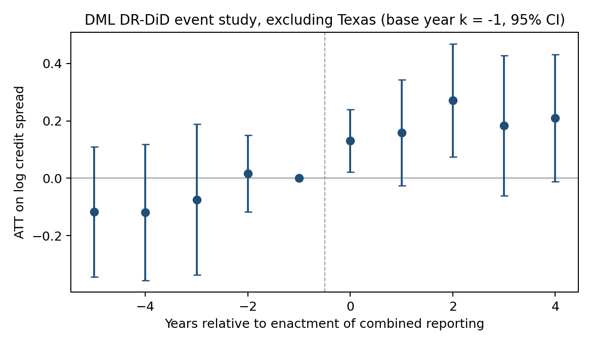
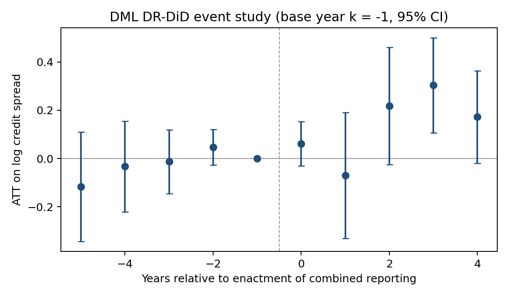

# Combined Reporting and the Cost of Corporate Debt: A Double Machine Learning Approach

When a U.S. state switches to combined reporting, a corporate group is taxed on its consolidated income: shifting
income to low-tax affiliates stops working, and losses in one affiliate offset profits in another. How do creditors perceive the effect of this tax reform on corporate debt burden? How this tax reform then affect corporate's cost of debt? This project measures how corporate bond spreads responded to the twelve
state adoptions between 2004 and 2018, using a stacked difference-in-differences design estimated with double
machine learning.

📄 **Paper:** [`docs/paper.md`](docs/paper.md) · 📊 **Detailed results:** [`results/report.md`](results/report.md)

---

## Key takeaways

1. **Combined reporting raises borrowing costs.** Bond spreads of firms operating in an adopting state widen by
   **12–13%** relative to firms with no exposure, or about **45–50 basis points** at the average spread. The paper's
   stacked fixed-effects regression gives 0.115 log points (t = 2.0), and the doubly-robust DML estimator gives
   0.127.

2. **Spreads rise from enactment and stay higher.** Excluding Texas, whose 2006 law also replaced its franchise tax
   with the margin tax, pre-trends are flat. Spreads rise **0.13 log points in the year of enactment** (t = 2.3) and
   **0.27 two years later** (t = 2.7), then stay around 0.2 through year four. In the full sample the effect peaks at
   +0.30 (t = 3.0) in year three.

3. **It is not Texas and not the financial crisis.**
   - Texas is two-thirds of the treated sample. Dropping it *raises* the estimate to **0.20 (t = 2.6)**.
   - Letting the 2008–09 crisis hit firms differently by pre-period credit risk and geographic breadth gives
     **0.145 (t = 2.8)**.

4. **R&D-intensive firms bear it.** Spreads widen by **0.41 log points** for firms with above-median R&D intensity and
   0.04 for the rest (difference t = 3.5). These are the firms that lose the most when intangible-income shifting is
   shut down.

5. **Machine learning aligns with the linear design.** Random forest, lasso and gradient boosting all land within 0.03 of
   the fixed-effects estimate, so the result does not depend on how controls enter.



*Effect of combined reporting on log credit spreads by year relative to enactment, excluding the Texas 2006 cohort
(DML doubly-robust DiD, base year −1, 95% confidence intervals; 296 firm × cohort units).*



*The same event study with all cohorts, including Texas (587 units).*

---

## What's under the hood

- **State footprints from 24,000 10-Ks.** Establishment data (Data Axle) is replaced by an EDGAR pipeline. It
  downloads every 10-K and annual-report exhibit for 1,364 bond issuers from 2000 to 2025. It reads state-by-state
  unit tables where firms report them, and otherwise counts state names near operations language. Legal-context
  mentions and the filer's own name are masked first.
- **Clean stacked comparisons.** Each adoption is its own experiment with a [−5, +4] window. Treated firms have no
  earlier exposure, and controls have no exposure through the end of the window. This avoids the bias of staggered
  two-way fixed effects.
- **Doubly-robust DML.** Machine-learning models estimate both who gets treated and how control spreads trend. They
  are combined in an orthogonal score that is cross-fitted by firm and repeated over ten fold splits. A simulation
  check (`test_synthetic.py`) confirms the estimator recovers a known effect.
- **Inference that respects few states.** Standard errors are clustered by firm. A permutation test reassigns
  adoption years across states (one-sided p = 0.06).

| | |
|---|---|
| Events | 12 state adoptions, 2004–2018 (VT, TX, MI, WV, MA, WI, DC, NY, RI, CT, KY, NJ) |
| Outcome | Log credit spread: TRACE yield minus maturity-matched Treasury, firm-year |
| Sample | 11,652 firm-years, 1,266 issuers, 2002–2025; 402 treated and 185 clean-control firm × cohort units |
| Main estimate | +0.115 (stacked FE OLS), +0.127 (DML DR-DiD) log points |
| Excluding Texas | +0.201 log points (DML DR-DiD, t = 2.6) |
| Peak effect | +0.27 in year 2 excluding Texas; +0.30 in year 3 with all cohorts |

## Repository

```text
docs/paper.md                    the paper
docs/design.md                   research design and mapping from Welsch (2025)
results/report.md                detailed results, diagnostics and robustness
results/*.png, results/*.csv     all figures and estimate tables
cr_events.csv                    adoption events (enactment and effective dates)
state_panel.csv                  state tax rates, unemployment, GDP growth (2000–2025)
edgar_state_exposure.py          10-K download and state-footprint parser
build_state_panel.py             ITEP tax rates + FRED state data
build_firm_panel.py              spreads + Compustat controls (licensed inputs, not included)
dml_cr.py                        stacking, long differences, DML estimators, stacked FE OLS
run_analysis.py                  main estimates, event study, robustness, heterogeneity
crisis_tests.py                  Texas and financial-crisis tests
headline_figure.py               headline event study (excluding Texas)
event_study_drop_crisis.py       event study without the 2007–09 cohorts
placebo.py                       permutation test over adoption years
test_synthetic.py                simulation check of the estimators
run_pipeline.sh                  10-K fetch → parse → shares → analysis
```

## Reproduce

TRACE, Mergent FISD and Compustat are licensed through WRDS and are not included. `build_firm_panel.py` expects the
firm-year spread file and Compustat extracts at the paths listed at its top. Everything else uses public data:

```bash
python3 -m pip install -r requirements.txt
python3 build_state_panel.py                                    # ITEP + FRED
export SEC_USER_AGENT="Your Name your.email@domain"             # SEC fair-access policy
python3 edgar_state_exposure.py index                           # EDGAR 10-K index
python3 edgar_state_exposure.py fetch --link gvkey_cik_spreadfirms.csv   # ~2 hours, ~2.6 GB cache
python3 edgar_state_exposure.py parse
python3 edgar_state_exposure.py shares --link gvkey_cik.csv --out exposure_10k.csv
python3 build_firm_panel.py
OMP_NUM_THREADS=4 python3 -u run_analysis.py                    # ~13 minutes
python3 -u crisis_tests.py && python3 headline_figure.py && python3 -u placebo.py 100
```

`gvkey_cik.csv` maps Compustat `gvkey` to SEC `cik` (from `comp.funda`); `gvkey_cik_spreadfirms.csv` is its subset
for firms with spreads. Neither is included. Python 3.12 · pandas · scikit-learn ·
matplotlib.
