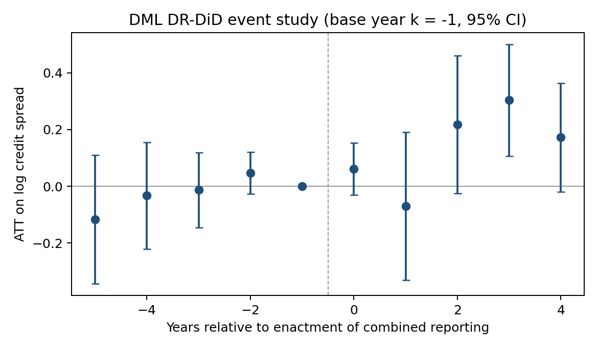
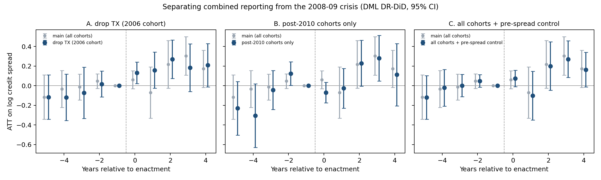

# Taxed Together: State Combined Reporting and the Cost of Corporate Debt

**Yingrui Song**
November 2026

---

## Abstract

Between 2004 and 2018, twelve U.S. states moved from separate-entity to combined reporting for the corporate income
tax. Under combined reporting, a corporate group pays state tax on its consolidated income, which closes
income-shifting structures and pools gains and losses across affiliates. This paper asks how bond markets priced the
change. I build each firm's state footprint from 24,000 10-K filings and estimate a stacked difference-in-differences
design with clean controls on 1,266 bond issuers in TRACE, 2002–2025. Spreads of firms operating in an adopting state
widen by 12 percent relative to unexposed firms in the stacked fixed-effects specification (0.115 log points,
t = 2.0), or about 45 basis points at the sample mean. A doubly-robust double machine learning (DML) estimator gives
0.127. The effect builds gradually and peaks three years after enactment at 0.30 log points (t = 3.0), with flat
pre-trends. It does not come from Texas, the largest adopting cohort, or from the 2008–09 financial crisis. Excluding
Texas the estimate rises to 0.20 (t = 2.6). Fixed effects that let crisis exposure vary with pre-period credit risk
and geographic breadth give 0.145 (t = 2.8). The widening is concentrated among R&D-intensive firms, the firms that
lose the most from the end of intangible-income shifting. Creditors price combined reporting as a cost to the firm
rather than as insurance.

---

## 1. Introduction

A state that taxes corporations on a separate-entity basis taxes each legal entity with nexus in the state on its
own income. Multistate groups can therefore move taxable income out of the state, typically by placing intangible
property in an affiliate in a low-tax jurisdiction and charging royalties to the operating entities. Combined
reporting closes this route. The group's income is added up across affiliates and apportioned to the state by
formula. Losses in one affiliate offset profits in another, and intercompany royalties disappear.

Welsch (2025) shows that these reforms change corporate risk-taking: the loss-sharing feature of combined reporting
acts as partial insurance and firms respond with riskier operations. This paper asks the creditors' question.
Creditors care about the downside of the firm's cash-flow distribution, and combined reporting changes that downside
in two opposing ways. Loss pooling truncates the after-tax downside, which should narrow spreads. Higher tax burdens,
the loss of shifting structures, and more risk-taking all lower or spread out cash flow available for debt service,
which should widen them. Bond prices aggregate these channels, so the sign is an empirical question.

I follow Welsch's design and adapt it to bond spreads and to public data. The events are the twelve adoptions from
Vermont (2004) to Kentucky and New Jersey (2018). Each adoption is a separate cohort with a window from five years
before to four years after enactment. Treated firms have operations in an adopting state and no earlier exposure to
combined reporting; clean controls have no operations in any state that adopts within the window. Firm footprints
come from the text of 10-K filings rather than from establishment data. Effects are estimated two ways. The first is
the paper's stacked regression with firm × cohort and industry × year × cohort fixed effects. The second is a
doubly-robust DiD estimator in which machine-learning models estimate both the propensity to be treated and the
control group's spread trend (Chang 2020; Chernozhukov et al. 2018).

Three findings emerge.

1. **Combined reporting raises borrowing costs.** Spreads of exposed firms widen by 12–13 percent relative to clean
   controls, about 45–50 basis points at the sample mean spread of 383 basis points. The linear and machine-learning
   estimators agree within 0.03 log points.
2. **The effect builds over three years and is not an artifact of Texas or the financial crisis.** Pre-trends are
   flat, the response at enactment is small, and the peak comes at year three. Dropping Texas, whose 2006 cohort is
   two-thirds of the treated sample, raises the estimate. Allowing the 2008–09 crisis to hit riskier and more
   geographically spread-out firms harder leaves it intact.
3. **It is concentrated in R&D-intensive firms.** Among firms with above-median R&D intensity, spreads widen by 0.41
   log points; among the rest, by 0.04. This is the group whose intangible-income shifting combined reporting ends.

The rest of the paper is organized as follows. Section 2 describes the data. Section 3 lays out the design. Section 4
presents results and Section 5 concludes.

---

## 2. Data

**Credit spreads.** Bond spreads are computed from TRACE transactions matched to Mergent FISD bond characteristics,
as the bond's yield to maturity minus the maturity-matched yield on the zero-coupon Treasury curve. They are
aggregated from bond-day to the firm-year, weighting bonds by offering amount. After excluding financials,
utilities and public administration, the sample has 11,652 firm-years for 1,266 firms between 2002 and 2025. The mean
spread is 383 basis points (median 282). The outcome is the log spread.

**Firm controls.** From Compustat: size, book and market leverage, market-to-book, ROA and its five-year volatility,
cash, R&D, capital expenditure, tangibility, losses, sales growth and firm age. From the bond data: average remaining
maturity, number of bonds outstanding and trading volume. All controls enter as pre-period averages so that no
control can be affected by the reform.

**State footprints.** Welsch (2025) measures nexus with Data Axle establishment counts. I build an equivalent from
public filings. For each firm I download every 10-K filed between 2000 and 2025 from SEC EDGAR, 23,989 filings for
1,364 firms. A state's share of the firm's footprint is computed from three sources, in order of priority:

- unit-count tables (for example, stores or facilities by state), used for 8 percent of firm-years;
- state names within 25 words of operations language (facilities, stores, plants, employees), 91 percent;
- all state mentions, 0.5 percent; and headquarters state only, 0.3 percent.

Legal-context mentions (state of incorporation, governing law, courts) and the filer's own name are masked before
counting. Each firm's
shares are fixed at their average over the five pre-event years of each cohort, which removes year-to-year noise in
the text.

**State variables.** Top corporate income tax rates come from the Institute on Taxation and Economic Policy (ITEP)
historical tables; Texas's franchise and margin tax and Michigan's Single Business Tax are added by hand. State
unemployment and real GDP come from FRED. Each enters as a nexus-weighted average of the states where the firm
operates, together with the number of states and the share of the footprint in states that already had combined
reporting before 1990.

**Events.** Table 1 lists the adoption cohorts by enactment year. New Mexico (2019) is excluded as in Welsch (2025).

**Table 1. Adoption cohorts and sample**

| Cohort (enacted) | States | Treated firms | Clean controls |
|---|---|---|---|
| 2004 | VT | 24 | 31 |
| 2006 | TX | 253 | 38 |
| 2007 | MI, WV | 43 | 21 |
| 2008 | MA | 19 | 21 |
| 2009 | WI | 12 | 25 |
| 2011 | DC | 29 | 8 |
| 2014 | NY, RI | 19 | 15 |
| 2015 | CT | 0 | 12 |
| 2018 | KY, NJ | 3 | 14 |
| **Total** | | **402** | **185** |

Most bond issuers already operate in an early adopter, so later cohorts have few treated firms that are not
previously treated.

---

## 3. Empirical Design

**Stacked cohorts.** For cohort *e*, the window runs from *e* − 5 to *e* + 4. A firm is treated in cohort *e* if it
operates in a state adopting in *e* and has no footprint in any earlier adopter. A firm is a clean control if it has
no footprint in any state adopting on or before *e* + 4. Cohorts are stacked so that each comparison uses only
not-yet-treated or never-treated controls, which avoids the bias that arises when already-treated firms serve as
controls under staggered adoption (Cengiz et al. 2019; Baker, Larcker and Wang 2022). Event time is measured from
enactment, because bond prices respond to news.

**Stacked regression.** The first estimator is Welsch's equation:

> log spreadi,t,e = β · Treatedi,e × Postt,e + αi,e + δj,t,e + εi,t,e,

with firm × cohort effects α and industry × year × cohort effects δ.

**Doubly-robust DML.** The second estimator removes the linearity assumption. For each firm × cohort unit, I take
the long difference in log spreads, post-period mean minus pre-period mean. I then estimate the average effect on the
treated using the doubly-robust score of Sant'Anna and Zhao (2020), with two machine-learning nuisance functions: the
probability of treatment given pre-period characteristics, and the expected spread change for controls given those
characteristics. The estimate is consistent if either function is correctly specified, and Neyman orthogonality
keeps first-stage estimation error out of the treatment effect (Chernozhukov et al. 2018). The details:

- Nuisance functions are cross-fitted over five folds grouped by firm.
- The learner (random forest, gradient boosting or regularized logit/ridge) is chosen by out-of-fold fit; random
  forest wins in the main specification.
- Results are the median over ten fold splits.
- Standard errors are clustered by firm, because control firms appear in several cohorts.

**Event study.** Year-by-year effects use the same DML estimator on the difference between year *e* + *k* and the
base year *e* − 1.

---

## 4. Results

### 4.1 Main estimates

Table 2 reports the pooled effect. In the stacked fixed-effects specification, spreads of treated firms rise by 0.115
log points (12 percent) relative to clean controls. The doubly-robust DML estimate is 0.127 (13.5 percent). The
flexible learners agree closely: random forest 0.132, lasso 0.130, gradient boosting 0.105. Overlap-trimming the
sample to propensities between 0.05 and 0.95 gives 0.140.

**Table 2. Effect of combined reporting on log credit spreads**

| Estimator | Estimate | SE | t |
|---|---|---|---|
| Stacked OLS, firm × cohort and industry × year × cohort FE | **0.115** | 0.058 | 1.97 |
| Long difference, no controls | 0.143 | 0.059 | 2.43 |
| Long difference, linear controls | 0.093 | 0.053 | 1.76 |
| DML doubly-robust DiD | **0.127** | 0.078 | 1.63 |
| DML, random forest | 0.132 | 0.077 | 1.73 |
| DML, lasso | 0.130 | 0.130 | 1.00 |
| DML, gradient boosting | 0.105 | 0.134 | 0.78 |
| DML, overlap-trimmed (0.05 ≤ p̂ ≤ 0.95) | 0.140 | 0.081 | 1.72 |

*587 firm × cohort units: 402 treated, 185 clean controls. Standard errors clustered by firm.*

The agreement between the linear and flexible estimators shows that the result does not depend on how the
pre-period controls enter. The DML standard errors are about a third larger than OLS, the price of not imposing the
linear model.

As a check on inference with a small number of adopting states, I randomly reassign adoption years across the twelve
states 100 times and re-estimate. The placebo distribution is centered at zero (mean −0.002, standard deviation
0.083). The actual estimate lies in the upper tail, with a one-sided permutation p-value of 0.06 (two-sided 0.11).

### 4.2 Dynamics

Figure 1 traces the effect by year relative to enactment. The four pre-period coefficients are small and
insignificant, so treated and control spreads moved in parallel before adoption. Spreads respond little in the year of
enactment. The effect then builds, reaching 0.22 log points in year two and 0.30 (35 percent, t = 3.0) in year three.

*Figure 1. DML doubly-robust event study. Effect on log credit spreads by year relative to enactment; base year −1;
95 percent confidence intervals.*

| Year | −5 | −4 | −3 | −2 | −1 | 0 | 1 | 2 | 3 | 4 |
|---|---|---|---|---|---|---|---|---|---|---|
| Estimate | −0.117 | −0.033 | −0.013 | 0.047 | 0 | 0.061 | −0.070 | 0.218 | **0.304** | 0.172 |
| SE | 0.116 | 0.096 | 0.068 | 0.038 | – | 0.047 | 0.133 | 0.124 | 0.100 | 0.097 |

The gradual profile fits a response that accumulates as the new regime takes effect. Combined reporting typically
becomes effective within two years of enactment, and its consequences for tax payments and tax planning become
visible in the filings that follow.

### 4.3 Texas and the financial crisis

Two features of the sample could produce the pattern in Figure 1 without any effect of combined reporting. First,
the Texas 2006 cohort is 63 percent of treated units, and the same Texas law replaced the franchise tax with the
margin tax. Second, years two and three for the Texas cohort are 2008 and 2009. If firms with Texas operations were
hit harder by the crisis, the event study would show a peak at exactly those horizons.

Table 3 addresses both. Dropping the Texas cohort *raises* the estimate to 0.20 log points (22 percent, t = 2.6). In
the remaining cohorts the crisis falls at different event years: years 4–5 for Vermont, 1–2 for Michigan and West
Virginia, 0–1 for Massachusetts, −1–0 for Wisconsin. A crisis artifact would be smeared across event time. Instead,
the no-Texas event study (Figure 2, left) shows a flat pre-period and a steady post-enactment rise.

The second test keeps all cohorts but replaces the industry × year × cohort effects with cohort × year × pre-period
spread quintile × number-of-states tercile effects. This lets the crisis, or any other common shock, hit firms with
different initial credit risk and geographic breadth differently. The estimate rises to 0.145 (16 percent, t = 2.8).
Adding the pre-period spread level to the DML covariates gives 0.130 and leaves the event-study profile unchanged.

**Table 3. Texas and the financial crisis**

| Specification | DML DR-DiD | Stacked OLS | Units (treated) |
|---|---|---|---|
| Main | 0.127 (0.078) | 0.115 (0.058) | 587 (402) |
| Excluding the Texas 2006 cohort | **0.201 (0.078)** | **0.132 (0.064)** | 296 (149) |
| Pre-period spread level as covariate | 0.130 (0.072) | — | 587 (402) |
| Cohort × year × pre-spread × number-of-states FE | — | **0.145 (0.053)** | 587 (402) |
| Post-2010 cohorts only | 0.050 (0.071) | −0.039 (0.115) | 100 (51) |

The cohorts adopted after 2010 have post-periods entirely after the crisis. Their event study has the same shape,
0.23 in year two and 0.28 in year three (Figure 2, middle), but with 51 treated firms the pooled estimate is imprecise.

*Figure 2. Event studies excluding Texas (left), for post-2010 cohorts only (middle), and controlling for pre-period
spread level (right), each against the main event study in grey.*

### 4.4 Robustness

Table 4 varies the definition of treatment and the sample. Using effective dates instead of enactment dates gives
0.180. Starting the sample in 2005, when TRACE coverage becomes complete, gives 0.242 (t = 2.1). Requiring treated
firms to have at least 5 percent of their footprint in the adopting state, and controls less than 1 percent, gives
0.137 (t = 2.1). Applying Welsch's rule of continuous presence in every year instead of fixed pre-period shares gives
0.154 (t = 2.4). The estimate in basis points is 26 (SE 41).

**Table 4. Robustness (DML doubly-robust DiD)**

| Specification | Estimate (SE) | Units |
|---|---|---|
| Main | 0.127 (0.078) | 587 |
| Effective-date timing | 0.180 (0.112) | 550 |
| Sample from 2005 | **0.242 (0.117)** | 499 |
| Treated ≥ 5% share, controls < 1% | **0.137 (0.065)** | 509 |
| Treated ≥ 10% share, controls < 2% | 0.084 (0.065) | 494 |
| Year-by-year presence rule (Welsch 2025) | **0.154 (0.063)** | 536 |
| Pre-period spread level as covariate | 0.138 (0.080) | 587 |
| Excluding 2007–09 cohorts | 0.066 (0.075) | 446 |
| Outcome in basis points | 26.4 (41.2) | 587 |

### 4.5 Which firms are affected

Table 5 splits treated firms at the median of pre-period characteristics, keeping all controls, and tests the
difference with firm-clustered influence functions. The effect is concentrated among R&D-intensive firms: 0.41 log
points against 0.04 for low-R&D firms (difference t = 3.5). Intangible-heavy firms gain most from holding
intellectual property in low-tax affiliates, and those are the structures combined reporting eliminates. The effect
is also larger for issuers with low pre-period spreads (0.26 against −0.07, t = −2.8). Both differences exceed the
Bonferroni threshold for seven splits (t = 2.69). The remaining splits (size, ROA volatility, leverage, number of
states, past losses) show no significant differences.

**Table 5. Effects by pre-period firm characteristics**

| Split | Below median | Above median | Difference (t) |
|---|---|---|---|
| R&D intensity | 0.039 (0.085) | **0.406 (0.084)** | **+0.367 (3.49)** |
| Pre-period spread | **0.256 (0.099)** | −0.073 (0.081) | **−0.329 (−2.79)** |
| Size | 0.016 (0.095) | 0.210 (0.090) | +0.194 (1.68) |
| ROA volatility | 0.095 (0.096) | 0.204 (0.064) | +0.109 (1.22) |
| Book leverage | 0.169 (0.095) | 0.048 (0.090) | −0.120 (−1.04) |
| Number of states | 0.154 (0.065) | 0.047 (0.120) | −0.107 (−0.85) |
| Any loss year | 0.140 (0.092) | 0.103 (0.096) | −0.036 (−0.31) |

### 4.6 Exposure intensity and fundamentals

Welsch's continuous treatment, the share of the footprint in adopting states times the state tax rate, has no
detectable slope (−0.015 per percentage point, SE 0.021), so spreads move with exposure, not with its measured
intensity. Text-based footprints measure where a firm operates more reliably than how much of its taxable income is
apportioned there, so intensity is the margin on which this measure is weakest. Annual accounting outcomes (ROA
volatility, leverage, losses, R&D) do not change significantly within the window: the response is visible in bond
prices before it is visible in annual financial statements.

---

## 5. Conclusion

Combined reporting raises the cost of corporate debt. Bond spreads of firms operating in adopting states widen by
about 12–13 percent relative to unexposed firms, with the full effect arriving about three years after enactment. The
increase is not driven by Texas or by the financial crisis. It is concentrated among R&D-intensive firms, the firms
that lose intangible-income shifting. For creditors, the costs of combined reporting outweigh the insurance value of
pooling losses across affiliates.

Two extensions would sharpen these results. Establishment-level footprints would measure exposure intensity and
apportionment directly. Bond-level spreads at weekly frequency around enactment dates would identify the price
response without relying on scarce clean controls.

---

## References

Baker, A. C., D. F. Larcker and C. C. Y. Wang (2022). "How Much Should We Trust Staggered Difference-in-Differences
Estimates?" *Journal of Financial Economics* 144(2), 370–395.

Cengiz, D., A. Dube, A. Lindner and B. Zipperer (2019). "The Effect of Minimum Wages on Low-Wage Jobs." *Quarterly
Journal of Economics* 134(3), 1405–1454.

Chang, N.-C. (2020). "Double/Debiased Machine Learning for Difference-in-Differences Models." *Econometrics Journal*
23(2), 177–191.

Chernozhukov, V., D. Chetverikov, M. Demirer, E. Duflo, C. Hansen, W. Newey and J. Robins (2018).
"Double/Debiased Machine Learning for Treatment and Structural Parameters." *Econometrics Journal* 21(1), C1–C68.

Sant'Anna, P. H. C. and J. Zhao (2020). "Doubly Robust Difference-in-Differences Estimators." *Journal of
Econometrics* 219(1), 101–122.

Welsch, A. (2025). "Riskier Together? The Effect of Combined Tax Reporting on Corporate Risk-Taking." Working paper,
SSRN 5649711.
