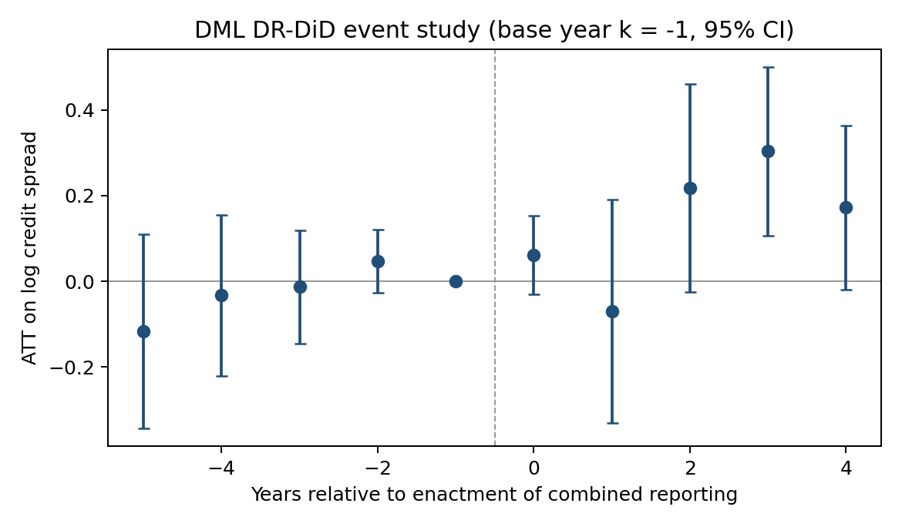
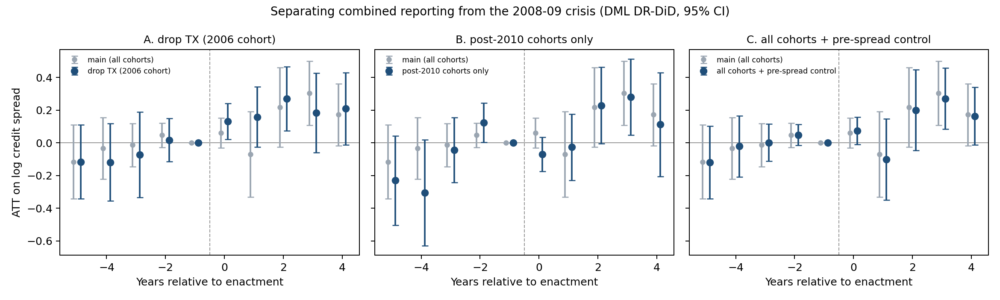
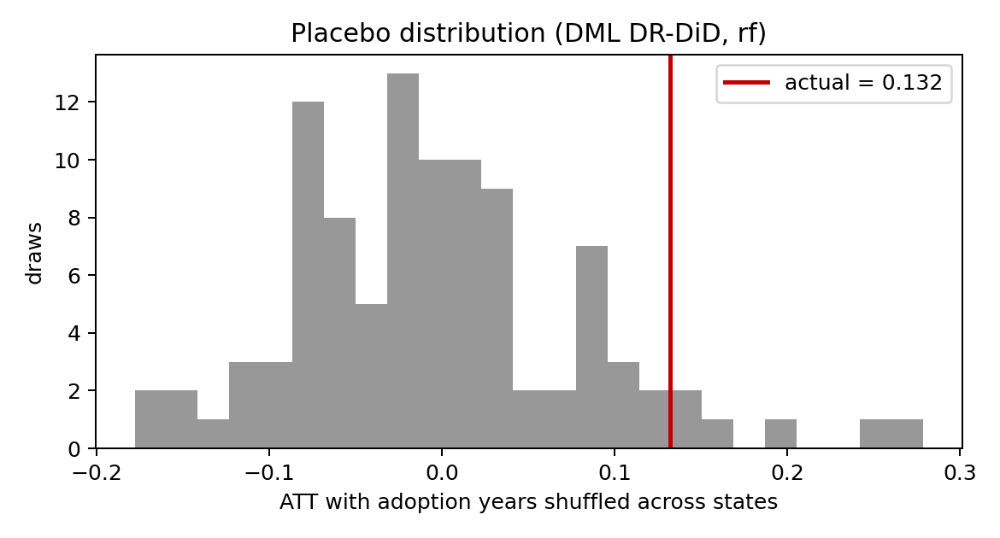
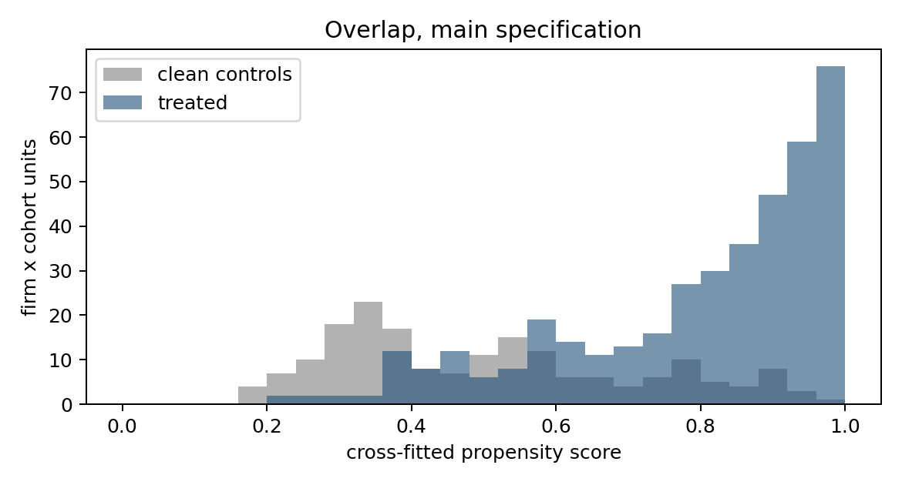

# Combined Reporting and Credit Spreads: DML Results

Run date: 2026-11-10. The design is in [docs/design.md](../docs/design.md); the paper is [docs/paper.md](../docs/paper.md). All numbers below come from
`results/estimates.csv`, `results/run_log_main.txt`, `results/heterogeneity.csv` and
`results/placebo.csv`.

## Bottom line

- **Point estimate.** Firms with nexus in a state that adopts combined reporting see their bond
  spreads widen by about **10–14%** relative to clean controls. The DML DR-DiD estimate is 0.127
  log points (SE 0.078). At the sample mean spread of about 380 bps, that is roughly 50 bps.
- **Statistical strength: marginal.** t-statistics run 1.6–2.4 across specifications. In the
  placebo test that shuffles adoption years across states, the two-sided permutation p-value is 0.11.
- **Timing.** Pre-trends are flat. The effect builds 2–4 years after enactment, with a peak of
  +0.30 at k = 3 (SE 0.10). It does not show up at enactment, which points to a slow change in
  credit risk rather than an immediate repricing of the news.
- **No dose response.** The continuous-dose models (the paper's CombinedApptTaxRate) are
  precisely zero in every specification: −0.015 per percentage point (SE 0.021). Text-based
  exposure shares are noisy, which biases slopes toward zero, so this is weak evidence against
  an exposure-intensity story, not strong evidence.
- **Where the effect sits.** It is concentrated in **R&D-intensive firms** (+0.41 versus +0.04,
  difference t = 3.5) and in **low-spread (safer) issuers** (+0.26 versus −0.07, t = −2.8). Both
  survive a Bonferroni correction for the 7 subgroup tests (critical t ≈ 2.69). The R&D pattern
  fits the paper's income-shifting channel: IP-heavy firms lose low-tax-state royalty structures
  and pay more state tax.
- **The main caveat is identification.** 63% of treated units come from the Texas 2006 cohort.
  Texas replaced its franchise tax with the margin tax in the same law, so the two cannot be
  separated. Clean controls are scarce (8–38 per cohort) because nearly every bond issuer
  mentions Texas, New York or New Jersey in its 10-K. Dropping TX, MI and NY leaves 52 units.
- **Neither Texas nor the 2008–09 crisis drives it (§4a).**
  - Dropping the TX 2006 cohort raises the estimate to 0.20 (SE 0.08).
  - Adding fixed effects for cohort × year × pre-spread × number of states gives 0.145 (SE 0.053).
  - Post-2010 cohorts on their own (51 treated) are too thin to confirm the effect.

Overall: the evidence suggests combined reporting *raised* spreads, the opposite of the
loss-offset "insurance" channel. It is not strong enough to claim a causal effect yet. §7 lists
what would make it stronger.

---

## 1. Data built for this exercise

| Piece | Source | Coverage |
|---|---|---|
| Credit spreads | Existing TRACE/FISD pipeline (`gvkey_year_credit_spreads.dta`) | 11,652 firm-years, 1,266 firms, 2002–2025, after dropping financials (NAICS 52), utilities (22) and public sector (92) |
| Firm controls | Compustat annual (`cash_holdings/raw/CompuStat.csv`) | Size, book and market leverage, MTB, ROA, ROA volatility (5-year rolling), cash, R&D, capex, tangibility, loss, sales growth, age; bond maturity, number of bonds, trading volume |
| Firm × state exposure | **EDGAR 10-Ks** (replaces Data Axle) | 23,989 10-Ks from 1,364 firms. Share source: operations-context mentions 91%, store/facility unit tables 8%, all mentions 0.5%, HQ only 0.3% |
| gvkey–CIK link | WRDS export (`comp.funda`, active + inactive) | 1,425 of 1,457 spread firms |
| State tax rates | ITEP State Tax Rate Historical Data v2026.2 (top CIT rate) | 51 states, 2000–2025. TX and MI filled by hand (see §6) |
| State economy | FRED: unemployment (`XXUR`), real GDP (`XXRGSP`) | 51 states, 2000–2025 |

## 2. Design actually estimated

- **Events.** Welsch (2025) App. D, 2004–2018 cohorts. NM is excluded.
- **Timing.** **Enactment year** in the main spec, because prices react to news. Effective year is a robustness check.
- **Windows.** [e−5, e+4], stacked.
- **Exposure.** Each firm's state shares are **frozen at their pre-period (e−5…e−1) 10-K average**.
  Reason: year-to-year text noise made almost every firm an entrant or leaver under the paper's
  presence-every-year rule. The literal rule is reported as a robustness check.
- **Groups.**
  - Treated: positive share in the cohort's states and no exposure to earlier adopters.
  - Clean control: zero share in every state that adopts up to e+4.
- **Estimator.** Long differences within firm × cohort (the analogue of firm×cohort FE), then
  DML doubly-robust DiD with Hajek-normalized weights:
  - 5-fold cross-fitting with folds split by firm;
  - 10 repeated fold splits;
  - SEs clustered by firm;
  - learners chosen automatically by out-of-fold fit among logit/ridge, gradient boosting and
    random forest. Random forest won both nuisances in the main spec.
- **Covariates.** Pre-period means of all firm controls, nexus-weighted tax rate, unemployment,
  GDP growth, pre-1990 combined-reporting share and number of states, plus industry and cohort indicators.
- **Final sample.** 587 firm × cohort units: 402 treated, 185 controls.

| Cohort (enacted) | States | Treated | Clean controls |
|---|---|---|---|
| 2004 | VT | 24 | 31 |
| 2006 | TX | 253 | 38 |
| 2007 | MI, WV | 43 | 21 |
| 2008 | MA | 19 | 21 |
| 2009 | WI | 12 | 25 |
| 2011 | DC | 29 | 8 |
| 2014 | NY, RI | 19 | 15 |
| 2015 | CT | 0 | 12 |
| 2018 | KY, NJ | 3 | 14 |

Later cohorts contribute almost nothing. Nearly every bond issuer was already exposed to an
earlier adopter, and earlier-treated firms are excluded, as in the paper.

## 3. Main estimates (outcome: log credit spread)

| Estimator | θ | SE | t |
|---|---|---|---|
| OLS long difference, no controls | 0.143 | 0.059 | 2.43 |
| OLS long difference, linear controls | 0.093 | 0.053 | 1.76 |
| Paper eq. 5: stacked OLS, firm×cohort + industry×year×cohort FE | 0.115 | 0.058 | 1.97 |
| … plus contemporaneous controls | 0.075 | 0.041 | 1.81 |
| **DML DR-DiD, auto learners (rf/rf)** | **0.127** | **0.078** | **1.63** |
| DML DR-DiD, random forest | 0.132 | 0.077 | 1.73 |
| DML DR-DiD, gradient boosting | 0.105 | 0.134 | 0.78 |
| DML DR-DiD, lasso | 0.130 | 0.130 | 1.00 |
| DML DR-DiD, logit/ridge | 0.048 | 0.120 | 0.40 |
| DML DR-DiD, overlap-trimmed sample (0.05 ≤ m̂ ≤ 0.95, n = 491) | 0.140 | 0.081 | 1.72 |
| DML DR-DiD, TX 2006 cohort only | 0.063 | 0.080 | 0.78 |
| **Dose:** DML PLR on CombinedApptTaxRate (per pp) | −0.015 | 0.021 | −0.74 |
| Dose: DML PLR on CombinedAppt (geographic share) | −0.041 | 0.131 | −0.32 |
| Dose: paper eq. 7, stacked OLS with FE | 0.008 | 0.017 | 0.46 |

Notes:
- The flexible learners (rf, lasso, gbm) agree on about 0.10–0.13. Logit/ridge is the outlier
  (0.05), and it also has the worst outcome fit (out-of-fold R² ≈ 0).
- DML standard errors are about 1.5 times OLS. Most of that is the price of not assuming the
  linear control model is correct.

## 4. Event study



| k | −5 | −4 | −3 | −2 | −1 | 0 | 1 | 2 | 3 | 4 |
|---|---|---|---|---|---|---|---|---|---|---|
| θ | −0.117 | −0.033 | −0.013 | 0.047 | 0 | 0.061 | −0.070 | 0.218 | **0.304** | 0.172 |
| SE | 0.116 | 0.096 | 0.068 | 0.038 | – | 0.047 | 0.133 | 0.124 | 0.100 | 0.097 |

- **Before the event:** no pre-trend. All pre-period estimates are within 1.3 SE of zero.
- **After the event:** the effect appears 2–4 years after enactment. The sample thins at long
  horizons, from 561 units at k = 0 to 428 at k = 4.

### 4a. Is the k = 2–4 rise just the 2008–09 crisis?

The concern: for the TX 2006 cohort, which is 63% of treated units, k = 2–3 falls in 2008–09.
Dropping the 2007–09 cohorts does not address it, because it keeps Texas
(`results/event_study_drop0709.png`). Three direct tests, all run by `crisis_tests.py` on the
saved main stack:

| Test | DML DR-DiD θ (SE) | Paper eq. 5 OLS θ (SE) | Units (treated) |
|---|---|---|---|
| Main | 0.127 (0.078) | 0.115 (0.058) | 587 (402) |
| A. Drop the TX 2006 cohort | **0.201 (0.078)** | **0.132 (0.064)** | 296 (149) |
| B. Post-2010 cohorts only (DC, NY, RI, CT, KY, NJ) | 0.050 (0.071) | −0.039 (0.115) | 100 (51) |
| C. All cohorts, pre-period spread level in X | 0.130 (0.072) | 0.115 (0.058) | 587 (402) |
| C. OLS with cohort × year × pre-spread quintile × number-of-states tercile FE | – | **0.145 (0.053)** | 587 (402) |



What each test shows:
- **A. Without Texas the effect gets larger, not smaller.**
  - The estimate is 0.20 (t = 2.6), and the TX cohort on its own gives only 0.06 (§3).
  - In the remaining cohorts, 2008–09 falls at different event times: VT k = 4–5, MI/WV
    k = 1–2, MA k = 0–1, WI k = −1–0. A crisis artefact would therefore be smeared across k,
    not lined up at one horizon.
  - Instead the event study shows a clean pre-period and a steady post-period rise: k = 0 is
    0.13 (SE 0.06) and k = 2 is 0.27 (SE 0.10).
  - Caveat: VT 2004 treated firms can pick up TX exposure at their k = 2.
- **B. Post-crisis cohorts are too thin to decide.**
  - The event-study shape is similar: k = 2 is 0.23 (SE 0.12) and k = 3 is 0.28 (SE 0.12).
  - But the pre-period is noisy (k = −4 is −0.31, k = −2 is +0.12, t = 2.0), and the pooled
    estimate is about zero.
  - There are 8–15 controls per cohort, and the 2011 cohort's pre-period covers 2006–10.
- **C. Allowing crisis sensitivity to vary with pre-period riskiness and geographic breadth
  does not remove the effect.**
  - The OLS with the richest fixed effects is the strongest estimate so far (t = 2.8).
  - The DML event study barely moves: k = 3 is 0.27 (SE 0.10).

**Verdict:**
- The 2008–09 crisis does not explain the result. The effect is not driven by Texas, and it
  survives flexible controls for differential crisis exposure.
- Post-crisis adoptions alone cannot confirm it, because there are too few of them.

## 5. Robustness (DML DR-DiD with auto learners; dose = PLR on CombinedApptTaxRate)

| Specification | Binary θ (SE) | Dose θ (SE) | Units |
|---|---|---|---|
| Main | 0.127 (0.078) | −0.015 (0.021) | 587 |
| Effective-date timing (paper's) | 0.180 (0.112) | 0.018 (0.025) | 550 |
| Drop TX, MI, NY (concurrent tax-base changes) | 0.282 (0.182) | 0.068 (0.041) | 52 |
| Drop 2007–09 cohorts (financial crisis) | 0.066 (0.075) | −0.023 (0.020) | 446 |
| Outcome in bps | 26.4 (41.2) | −5.6 (11.6) | 587 |
| Pre-period spread level in X | 0.138 (0.080) | −0.014 (0.017) | 587 |
| Sample from 2005 (full TRACE) | **0.242 (0.117)** | −0.005 (0.024) | 499 |
| Threshold: treated ≥ 5% share, controls < 1% | **0.137 (0.065)** | −0.015 (0.020) | 509 |
| Threshold: treated ≥ 10%, controls < 2% | 0.084 (0.065) | −0.030 (0.024) | 494 |
| Paper's year-by-year presence rules | **0.154 (0.063)** | 0.010 (0.020) | 536 |

**Placebo:** 100 draws that shuffle adoption years across the 12 adopting states. The placebo
mean is −0.002 (SD 0.083). The actual random-forest estimate is 0.132. Permutation p-values are
0.11 two-sided and 0.06 one-sided.



## 6. Heterogeneity and mechanisms

Each split divides the treated firms by a pre-period moderator and keeps all controls. The
difference is tested with firm-clustered influence functions.

| Moderator (pre-period) | θ, z = 0 | θ, z = 1 | Difference (t) |
|---|---|---|---|
| R&D intensity above median | 0.039 (0.085) | **0.406 (0.084)** | **+0.367 (3.49)** |
| Spread above median (riskier issuers) | **0.256 (0.099)** | −0.073 (0.081) | **−0.329 (−2.79)** |
| Size above median | 0.016 (0.095) | 0.210 (0.090) | +0.194 (1.68) |
| ROA volatility above median | 0.095 (0.096) | 0.204 (0.064) | +0.109 (1.22) |
| Book leverage above median | 0.169 (0.095) | 0.048 (0.090) | −0.120 (−1.04) |
| Number of states above median | 0.154 (0.065) | 0.047 (0.120) | −0.107 (−0.85) |
| Any loss year | 0.140 (0.092) | 0.103 (0.096) | −0.036 (−0.31) |

**Mechanism outcomes**, same design. None are significant:

| Outcome | θ (SE) |
|---|---|
| ROA volatility | −0.002 (0.006) |
| Book leverage | 0.003 (0.020) |
| Market leverage | 0.000 (0.027) |
| Loss indicator | 0.018 (0.047) |
| R&D/assets | 0.0008 (0.0005), t = 1.67 |

The annual 5-year rolling ROA volatility is a much coarser measure than the paper's quarterly
3-year forward measure, so not replicating the paper's risk-taking result here is uninformative.

## 7. Diagnostics and caveats



**Overlap and balance**
- Propensity AUC is 0.84, and 2.6% of units sit at the trimming bounds.
- Treated propensities pile up near 1 because treated firms mention many more states.
- `n_states` is the largest imbalance: standardized mean difference 1.19 raw and 0.60 after
  weighting. Trading volume (0.40), number of bonds (0.36) and maturity (0.30) also stay
  imbalanced after weighting. The doubly-robust estimate leans on the outcome model for these.
  That model's out-of-fold R² is 0.17, which is typical for spread changes.

**What limits a causal reading**
1. **Texas dominates, and its law bundled a tax-base change** (margin tax). The paper drops TX,
   MI and NY in robustness. Here that leaves 52 units, so the check has almost no power.
2. **Clean controls are firms whose 10-Ks never name an adopting state.** There are few of them,
   and they are more single-state and more regional. The comparison is partly "national versus
   regional bond issuers," and DML can only adjust for the observables listed above.
3. **Exposure comes from 10-K text, not establishment data.** Expect attenuation of the dose
   slopes and misclassification of some controls.
4. **Hand-coded tax rates.** ITEP codes non-income business taxes as 0. I filled in TX
   (franchise tax 4.5% through 2007; margin tax 1.0% 2008–13, 0.975% 2014, 0.95% 2015, 0.75%
   from 2016) and MI (Single Business Tax 2.2/2.1/2.0/1.9% for 2000–2007) in
   `build_state_panel.py`; these are not yet checked against statute. The geographic-dose results do not depend on these rates.
5. **Missing controls relative to the paper:** addback, throwback, sales-factor weight,
   market-based sourcing, NOL rules, investment and jobs credits, state ETR, stock return and
   equity volatility, ratings.

**What would make the result stronger**
- **Ratings:** FISD ratings for an IG/HY split and a rating-change outcome.
- **CRSP monthly returns:** equity volatility and distance to default, which are first-order
  spread controls.
- **Bond-level long differences:** about 98k bond-years, which adds power and removes
  composition effects in firm-level spreads.
- **High-frequency test:** weekly issuer spreads around each enactment date, a cleaner test that
  doesn't need clean controls.
- **Better exposure data** (Data Axle or NETS), if a license becomes available, to firm up the dose design.

## 8. Files and how to rerun

| File | Role |
|---|---|
| `build_state_panel.py` → `state_panel.csv` | ITEP rates + FRED unemployment and GDP |
| `build_firm_panel.py` → `firm_panel.csv` | Spreads + Compustat controls |
| `edgar_state_exposure.py` → `exposure_10k.csv` | 10-K exposure (cache in `edgar_cache/`, about 24k filings) |
| `dml_cr.py` | Stacking, long differences, DML estimators, stacked FE OLS |
| `run_analysis.py` → `results/` | Everything in §3–6 (12.5 minutes) |
| `placebo.py` → `results/placebo.*` | Permutation test (4.3 minutes) |
| `event_study_drop_crisis.py` → `results/event_study_drop0709.*` | Event study without the 2007–09 cohorts (2 minutes) |
| `crisis_tests.py` → `results/crisis_tests.csv`, `crisis_event_studies.*` | §4a crisis-separation tests (7 minutes) |
| `test_synthetic.py` | Simulation check: DML recovers the true effect, OLS doesn't |
| `run_pipeline.sh` | Fetch → parse → shares → analysis, unattended |

```bash
OMP_NUM_THREADS=4 python3 -u run_analysis.py && python3 -u placebo.py 100
```
